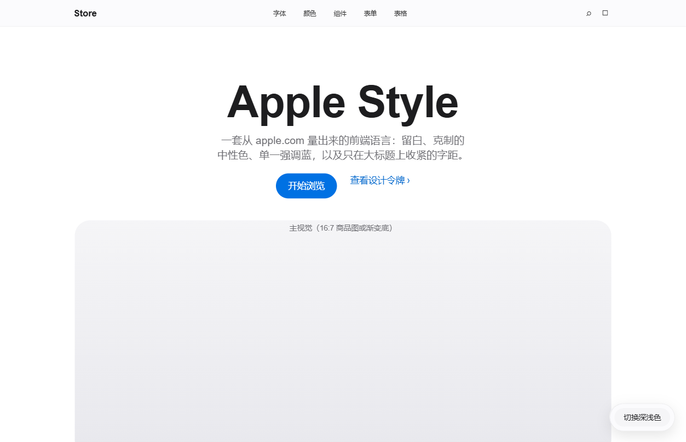
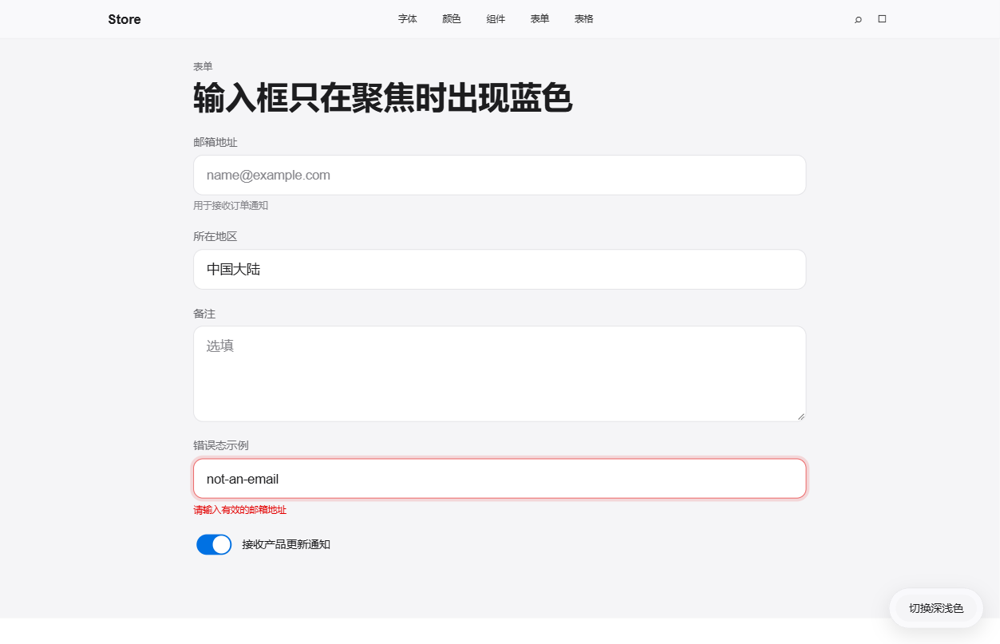

# apple-style

一个让 agent 把前端改成 **苹果风格** 的 skill（Claude/DSH 风格 skill：`SKILL.md` + `references/` + `assets/` + `scripts/`）。

不是"圆角+毛玻璃"的玄学，而是把 <https://www.apple.com.cn/store> 实际加载的 CSS 里的令牌量出来，固化成可直接套用的设计系统。

## 里面有什么

| 路径 | 说明 |
| --- | --- |
| `SKILL.md` | skill 入口：7 条「做完的标准」、5 步流程、12 项验收清单、反模式、各框架落地方式 |
| `assets/apple.css` | 令牌层 + 全部 `.ap-*` 组件类（导航、按钮、卡片、表单、表格、弹层、页脚），含深色模式 |
| `assets/tailwind-apple.js` | Tailwind preset，颜色/字号/圆角/阴影/间距/断点一一对应 |
| `assets/demo.html` | 参考页，组件全覆盖；改完页面拿它并排比对 |
| `references/design-tokens.md` | 逐项量出来的令牌表（浅色 + 深色），带来源说明 |
| `references/components.md` | 9 类组件配方（markup + CSS） |
| `references/motion-and-materials.md` | 毛玻璃材质分级、阴影层级、动效曲线与上限 |
| `references/workflow.md` | 盘点命令、8 步迁移顺序、框架特化说明、QA 流程、迁移陷阱 |
| `scripts/audit-apple-style.mjs` | 静态审查：越界颜色 / 圆角 / 阴影 / 字体 / 过渡时长 / 装饰性渐变 |

## 关键令牌（实测，非印象）

| 项 | 值 |
| --- | --- |
| 文字主色 | `#1d1d1f`，次要 `#6e6e73`，三级 `#86868b` |
| 分割线 | `#d2d2d7` |
| 背景 | 画布 `#ffffff`，区块 `#f5f5f7`，更暗 `#e8e8ed` |
| 强调色 | `#0071e3`（hover `#0076df`，active `#006edb`），链接 `#06c` |
| 导航材质 | `rgba(250,250,252,.8)` + `saturate(180%) blur(20px)`，滚动后 `.92` |
| 字体栈 | `"SF Pro Display"` / `"SF Pro Text"` / `-apple-system` / `"PingFang SC"` |
| 字距 | 标题 -.022em ~ -.009em，正文 -.022em（CJK 归零） |
| 圆角 | 0 / 3 / 4 / 5 / 6 / 8 / 10 / 12 / 18 / 20 / 28 / 980px(pill) |
| 阴影 | 最重 `0 8px 24px rgba(0,0,0,.10)`，只在浮层与 hover 上 |
| 断点 | 1068 / 734 / 480px |

## 用法

### 作为 skill 使用

把整个仓库放进你的 skills 目录（例如 `~/.dsh/skills/apple-style/` 或 `~/.claude/skills/apple-style/`），然后让 agent：

> 用 apple-style 把这个项目的界面改成苹果风格

agent 会按 `SKILL.md` 的流程走：先盘点现有配色/圆角/阴影 → 铺令牌层 → 按配方重组组件 → 调排版节奏 → 截图验收 + 跑审查脚本。

### 直接用 CSS

```html
<link rel="stylesheet" href="assets/apple.css">
<body class="ap-body">
  <nav class="ap-nav"><div class="ap-nav-inner">
    <a class="ap-nav-brand" href="#">Store</a>
    <div class="ap-nav-links"><a href="#">Mac</a><a href="#">iPhone</a></div>
  </div></nav>
  <button class="ap-btn ap-btn-primary">加入购物袋</button>
  <input class="ap-input" placeholder="name@example.com">
</body>
```

### Tailwind

```js
// tailwind.config.js
module.exports = { presets: [require('./assets/tailwind-apple.js')], content: ['./src/**/*.{html,jsx,tsx,vue}'] }
```

### 审查已有项目

```bash
node scripts/audit-apple-style.mjs ./src          # 人类可读
node scripts/audit-apple-style.mjs ./src --json   # 机器可读
```

有发现时退出码为 1，可直接接进 CI。

## 注意：层叠陷阱

`apple.css` 的基础元素规则用 `:where()` 包裹，特异度为 0，所以 `.ap-*` 类永远能赢。往已有项目里移植时**不要去掉这层 `:where()`** —— 去掉后 `body.x h1` 会压过 `.ap-btn-primary`，表现为按钮文字变成链接蓝、品牌字变色。这是引入现成设计系统最常见的静默失败。

## 视觉参考




直接打开 `assets/demo.html` 可以看到完整组件与深浅色切换。

## 说明

令牌取自 apple.com.cn/store 及其加载的 `ac-globalnav.css`、`common.css`、`store-home.css` 等文件（2026-11-24）。本项目与 Apple Inc. 无关，不含 Apple 的商标、字体文件或产品图片。

## License

GPL-3.0，见 [LICENSE](LICENSE)。
